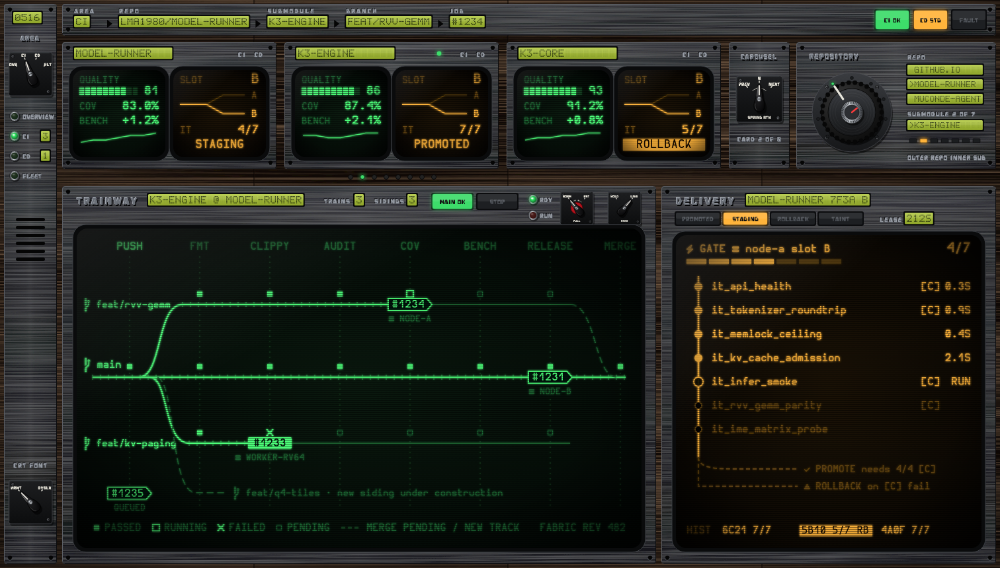

# MuConsole

<p align="center">
  
</p>

<p align="center">
  <a href="https://hook.lma1980.duckdns.org/jobs"></a>
  <a href="https://hook.lma1980.duckdns.org/jobs"></a>
  <a href="https://hook.lma1980.duckdns.org/jobs"></a>
  <a href="https://hook.lma1980.duckdns.org/jobs"></a>
</p>

______________________________________________________________________

Unified CI/CD console for **ActionRunner** (continuous integration) and **MuConDe** (continuous delivery). MuConsole is an SVG-first "Avionics Terminal" UI driven by two WebAssembly modules: a UI module on the main thread and a data module in a dedicated Web Worker. It is hosted on `https://console.lma1980.duckdns.org` in parallel with `ActionRunner-web` on `https://hook.lma1980.duckdns.org` (where the GitHub `POST /webhook` endpoint permanently remains) so both clients can be evaluated side-by-side without loss of functionality.

See the [design specification](docs/design/README.md).

______________________________________________________________________

## Workspace

| Crate                                             | Target             | Licence                                       | Responsibility                                                                                                                                                                                                                                |
| ------------------------------------------------- | ------------------ | --------------------------------------------- | --------------------------------------------------------------------------------------------------------------------------------------------------------------------------------------------------------------------------------------------- |
| [`muconsole-protocol`](crates/muconsole-protocol) | native + wasm      | LGPL-3.0-only WITH LGPL-3.0-linking-exception | `UiCommand` / `DataEvent`, view models, versioned postcard codec                                                                                                                                                                              |
| [`muconsole-theme`](crates/muconsole-theme)       | native + wasm      | AGPL-3.0-only                                 | Material tokens, 5×7 LCD glyphs, Nerd icon table, font metrics, dependency-free SVG writer and instrument generators (plate, etch/emboss, LCD, pistol-grip control switch, indicating lamp, annunciator, CRT, concentric rotary, wood veneer) |
| [`muconsole-layout`](crates/muconsole-layout)     | native + wasm      | AGPL-3.0-only                                 | Breakpoints, frame solver, metric-aware CRT column grid (zero page scroll)                                                                                                                                                                    |
| [`muconsole-ui`](crates/muconsole-ui)             | wasm (main thread) | AGPL-3.0-only                                 | SVG renderer (Leptos lands in Phase 3)                                                                                                                                                                                                        |
| [`muconsole-data`](crates/muconsole-data)         | wasm (worker)      | AGPL-3.0-only                                 | Fetch, SSE, store, diffing (Phase 2)                                                                                                                                                                                                          |

## Building & Verification

```bash
# Pre-PR gate (formatting first, so wrapping never trips length lints)
cargo fmt --all -- --check
./scripts/format_docs.sh --check
cargo clippy --workspace --all-targets -- -D warnings
cargo test --workspace
cargo check --target wasm32-unknown-unknown -p muconsole-ui -p muconsole-data -p muconsole-protocol -p muconsole-theme
```

### Fonts

Font binaries are **never committed**. `scripts/fetch-fonts.sh` downloads the pinned Nerd Fonts release zips (Hermit, OpenDyslexic, HeavyData), verifies their SHA-256, subsets them with `pyftsubset` (fontTools in a local `.venv`) using the code point list generated from `muconsole-theme::glyphs`, checks that every required glyph survived, and writes WOFF2 files, each family's licence and a hash manifest into `dist/fonts/`.

```bash
./scripts/fetch-fonts.sh
cargo run -q -p muconsole-theme --bin muconsole-subset-unicodes -- crt   # pyftsubset --unicodes list
```

| Subset                                | Licence (as shipped in the Nerd Fonts zip)              |
| ------------------------------------- | ------------------------------------------------------- |
| Hurmit Nerd Font Mono (Regular, Bold) | SIL OFL 1.1 (Reserved Font Name "Hermit")               |
| OpenDyslexicM Nerd Font Mono          | Bitstream Vera–style licence (`LICENSE.txt` in the zip) |
| HeavyData Nerd Font                   | Vic Fieger freeware licence (not OSI/OFL)               |

## License

MuConsole is licensed under the GNU Affero General Public License v3.0 (**AGPL-3.0-only**). See [LICENSE](LICENSE).

The IPC crate [`muconsole-protocol`](crates/muconsole-protocol) is licensed under the GNU Lesser General Public License v3.0 with the LGPL-3.0 Linking Exception (**LGPL-3.0-only WITH LGPL-3.0-linking-exception**), so other front-ends can link it without adopting the AGPL. See [its LICENSE](crates/muconsole-protocol/LICENSE), [COPYING](crates/muconsole-protocol/COPYING) (GPL-3.0) and [LINKING-EXCEPTION](crates/muconsole-protocol/LINKING-EXCEPTION).
