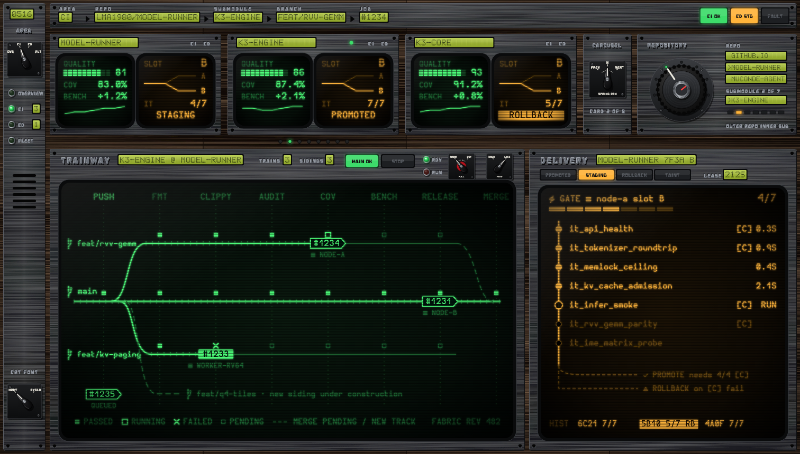
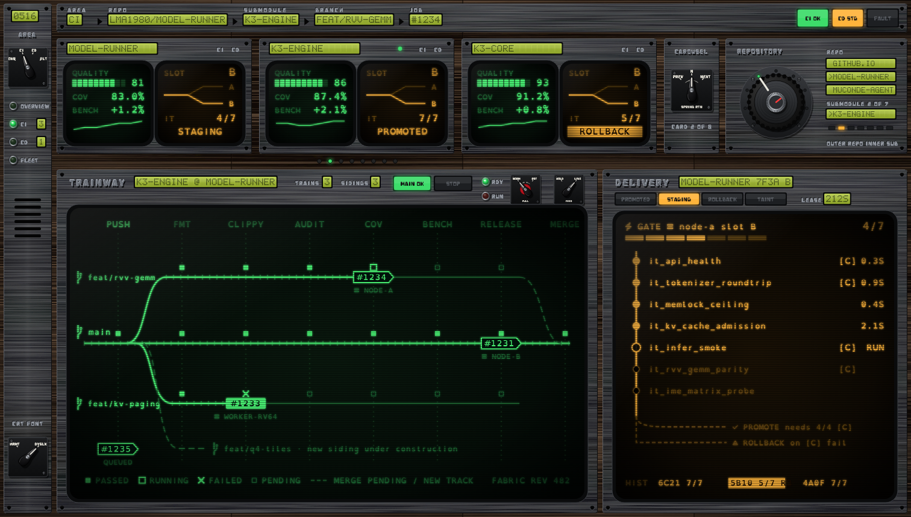
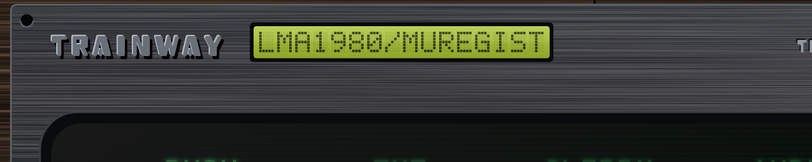
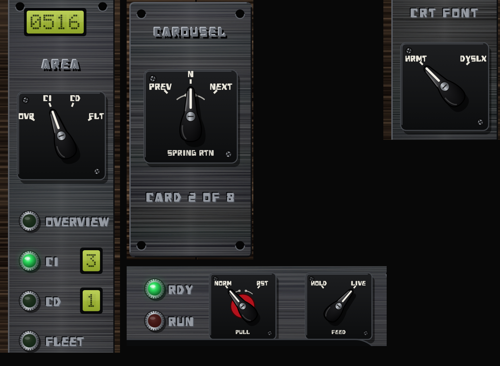
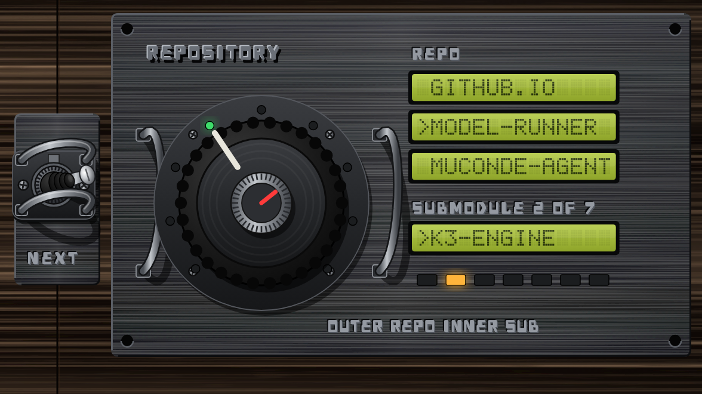
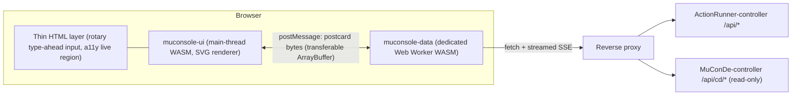

# MuConsole Design Specification

MuConsole is one console for **continuous integration** (ActionRunner) and **continuous delivery** (MuConDe). It has four parts:

- A shared dark **"Avionics Terminal" theme**: hardwood veneer, dark tungsten plates, nuclear-control-room pistol-grip switches with indicating lamps, CRT terminals and dot-matrix LCD labels.
- A **Trainway** view that draws each repository as a railway, with feature branches as parallel sidings, and a CD **integration-test gate** tracker.
- An **SVG-first component model** driven by two WASM modules: a UI module on the main thread and a data module in a Web Worker.
- A **no-scroll layout** for a 14" laptop and a mobile layout for a 402-pt-wide phone.

| Concept                                                                                                                                                    | Rendering                                                       |
| ---------------------------------------------------------------------------------------------------------------------------------------------------------- | --------------------------------------------------------------- |
| Desktop, Hurmit CRT font (default)                                                                                                                         |                  |
| Desktop, OpenDyslexicM CRT font (same column grid, metric-aware size)                                                                                      |  |
| Satin-brushed tungsten plate, embossed title, LCD window (@3x)                                                                                             |                          |
| Pistol-grip switches: 4-position area selector with lamps, spring-return carousel switch, PULL-TO-TURN restart with RDY/RUN lamps, CRT font selector (@4x) |                            |
| Concentric repository rotary with LCD drum and submodule lamps (@3x)                                                                                       |                              |

The renders come from [`gen_concept.py`](gen_concept.py), the visual reference for `muconsole-theme`. Run `scripts/fetch-fonts.sh` first; the generated SVGs embed the HeavyData subset and are never committed.

## 1. Target Viewports & Scroll Budget

| Device                          | CSS viewport | Usable canvas (design target)                                | Notes                                             |
| ------------------------------- | ------------ | ------------------------------------------------------------ | ------------------------------------------------- |
| 14" laptop (default scaling)    | 1512×982     | **1512×860** (browser toolbar + tab bar)                     | Fullscreen / PWA gets about 1512×944              |
| 14" laptop ("More Space")       | 1800×1169    | 1800×1040                                                    | The layout grows; no new breakpoint               |
| Phone portrait (402×874 pt, 3×) | 402×874      | **402×≈720** in the browser, **402×778** as an installed PWA | Safe areas ≈ 62 pt top, 34 pt bottom              |
| Phone landscape                 | 874×402      | 874×≈340                                                     | Compact layout: rail on the left, no carousel row |

> [!IMPORTANT]
> **Invariant: zero page-level scroll.** `html, body { overflow: hidden; height: 100dvh }`. Overflow inside a panel uses **panel-local paging** (pager plus keyboard / swipe), not scrollbars. Exceptions: the log viewer and the repo-picker list, which use virtualized panel scrolling.

Mobile toolbar heights change as the browser chrome collapses, so the solver uses the live `visualViewport` size (`Viewport::from_visual_viewport`) instead of hard-coded heights.

## 2. Architecture



| Crate                 | Path            | Target        | Licence                                       | Responsibility                                                                                    |
| --------------------- | --------------- | ------------- | --------------------------------------------- | ------------------------------------------------------------------------------------------------- |
| `mu-console-protocol` | `code/protocol` | native + wasm | LGPL-3.0-only WITH LGPL-3.0-linking-exception | `UiCommand` / `DataEvent` enums, view models, postcard codec, protocol version                    |
| `mu-console-theme`    | `code/theme`    | native + wasm | LGPL-3.0-only WITH LGPL-3.0-linking-exception | Material tokens, instrument library, Full / Lite / Auto intensity, generated `tokens.css`         |
| `mu-console-layout`   | `code/layout`   | native + wasm | LGPL-3.0-only WITH LGPL-3.0-linking-exception | Pure solver `solve(viewport, safe_area, area, font) -> Frames`, tested natively for "no overflow" |
| `mu-console-ui`       | `code/ui`       | wasm (main)   | AGPL-3.0-only                                 | Root `<svg>` renderer, components, router, input handling                                         |
| `mu-console-data`     | `code/data`     | wasm (worker) | AGPL-3.0-only                                 | Fetching, SSE parsing, normalized store, diffing, coalescing (≤ 10 Hz), offline cache             |

### 2.1 Worker protocol

- **UI → Data**: `Subscribe(Route)`, `SelectRepo { repo, submodule }`, `Page { panel, cursor }`, `Retry`, `SetVisibility { hidden }`, `SetCrtFont(font)`. When the tab is hidden, the worker throttles to heartbeat-only.
- **Data → UI**: `Snapshot(ViewModel)`, `Patch(Vec<Delta>)`, `Connection(ConnState)`, `Error(UiError)`.
- Frames are `varint(u32 protocol version) ++ postcard(body)` in transferable `ArrayBuffer`s. A version mismatch is reported as `UiError::VersionMismatch` and shown as a "reload required" banner.
- SSE runs on `fetch` + `ReadableStream` inside the worker with a hand-written line parser, avoiding `EventSource`-in-worker differences between engines.

### 2.2 Rendering model (hybrid SVG)

- One root `<svg>` sized to the viewport. Every component is an SVG `<g>` placed at a frame from `muconsole-layout`.
- A thin HTML layer carries only a visually hidden type-ahead `<input>` for the repository rotary (`font-size: 16px`), the `aria-live` region and the skip-link.
- Each component `<g>` has `role`, `aria-label` and `<title>`; interactive nodes get `tabindex="0"` and a focus ring.
- Keyboard: `[` / `]` switch area; `←` / `→` move the carousel; `/` focuses the rotary (`↑` / `↓` outer knob, `Shift`+`↑` / `↓` inner knob, typing jumps by prefix); `Esc` goes up one breadcrumb level.
- `prefers-reduced-motion` disables autoplay and transitions and forces Lite intensity. Dark is the only theme.

## 3. "Avionics Terminal" Theme

The console looks like a **cold-war control board / rail-signalling desk**:

- **Body:** dark hardwood veneer at cabinet scale.
- **Panel faces:** dark tungsten plates, brushed and bevelled. Static labels are acid-etched; mounting holes, vent slots and chevrons are punched through.
- **Controls:** pistol-grip rotary control switches on engraved black escutcheons, with red / green indicating lamps. No guards, covers or brass.
- **Dynamic text** lives in two places only: **fake CRT terminals** (green P1 phosphor for CI, amber P3 for CD) and **dot-matrix STN LCD windows** for single-line labels.

Rule of thumb: **etched means static, LCD means a dynamic label, CRT means a live view, and a lamp or annunciator means state.**

### 3.1 Material & colour tokens

| Material                        | Token          | Value                                                                              | Notes                                                                                                                                                                                                                                                                                                                                                                                                                |
| ------------------------------- | -------------- | ---------------------------------------------------------------------------------- | -------------------------------------------------------------------------------------------------------------------------------------------------------------------------------------------------------------------------------------------------------------------------------------------------------------------------------------------------------------------------------------------------------------------- |
| Hardwood veneer (wenge)         | `mat.wood`     | base `#120b07`, grain `#402616`, figure `#331f12`, pores `#050302`                 | About 1 CSS px = 0.6 mm (the 1512-px desk is ≈ 0.9 m wide). Fine long grain (`feTurbulence` 0.0011 × 0.46), broad figure (0.0007 × 0.018), open-pore dashes. Book-matched leaves 384 px wide with alternating tone and hairline seams. Grain density is fixed in CSS px and does not scale with the viewport.                                                                                                        |
| Tungsten plate                  | `mat.tungsten` | `#2b2d31` → `#17181b`                                                              | Fine satin brushing (`feTurbulence` 0.004 × 2.4, 3 octaves, amplitude 0.22) plus dark counter-lines (0.006 × 1.6) and a vertical-band sheen ≤ 7 % white. Bevel `#5a5e65` / `#0c0d0f`.                                                                                                                                                                                                                                |
| Acid etch                       | `ink.etch`     | face `#9499a1`, recess `#0b0c0e`, lip `#545961`                                    | Three-pass recessed HeavyData text                                                                                                                                                                                                                                                                                                                                                                                   |
| Emboss                          | `ink.emboss`   | face `#6a6f77`, lip `#b4b9c1`, shadow `#050506`                                    | Three-pass raised HeavyData text (titles)                                                                                                                                                                                                                                                                                                                                                                            |
| Punched hole                    | `mat.punch`    | `#050505` + lower lip `#5c6067`                                                    | Mounting holes, vent slots, chevrons                                                                                                                                                                                                                                                                                                                                                                                 |
| CRT CI phosphor (P1)            | `crt.ci`       | lit `#4dff7a`, dim `#1f6b34`, glass `#020604`–`#0b1a0f`                            | Bloom (`feGaussianBlur` 1.6), 3-px scanlines, vignette, glass sheen                                                                                                                                                                                                                                                                                                                                                  |
| CRT CD phosphor (P3)            | `crt.cd`       | lit `#ffb43a`, dim `#6b4a12`, glass `#060402`–`#1c1306`                            | Same pipeline                                                                                                                                                                                                                                                                                                                                                                                                        |
| STN LCD                         | `lcd.stn`      | backlight `#b6cc4a` → `#8ea42a`, pixel `#1c2608` @ 88 %, ghost @ 7 %               | 5×7 dot matrix with ghost cells                                                                                                                                                                                                                                                                                                                                                                                      |
| Control-room switch             | `mat.switch`   | bakelite `#4a4a4d` → `#050506`, escutcheon `#1d1e20` → `#0c0d0e`, legend `#e6e3d8` | Pistol-grip rotary control switch: square black escutcheon with two screws, engraved ticks and white legends; black bakelite grip with white pointer inlay and steel hub screw; positions in degrees (0° = up, clockwise positive). Variants: **maintained N-position selector**, **3-position spring-return-to-centre** (engraved return arrows) and **PULL-TO-TURN** with a red collar for state-changing actions. |
| Indicating lamps                | `mat.lamp`     | red `#ff3b30`, green `#2fe060`, amber `#ffb43a`; unlit tinted dark                 | Domed lenses in knurled steel bezels. Green = ready / normal / selected, red = running / energized, amber = caution.                                                                                                                                                                                                                                                                                                 |
| Accidental-operation protection | —              | —                                                                                  | No guards or covers. Maintained selectors need a deliberate rotation, spring-return switches cannot be left in an action position, and PULL-TO-TURN needs two motions (press-and-hold ≥ 300 ms then drag, or `Shift`+key).                                                                                                                                                                                           |
| Annunciators                    | `lamp.*`       | ok `#3ddc6a`, caution `#ffb43a`, warning `#ff3b3b`, off `#1d1f22`                  | Etched legend on the lens; dark legend when lit                                                                                                                                                                                                                                                                                                                                                                      |

**State encoding inside a single-colour CRT:** ■ filled = passed, ▢ blinking = running, ✕ = failed, ▫ hollow = pending, reverse video = failed train / rollback / taint, dashed track = merge pending or track under construction. These signals are drawn as SVG primitives, never as font glyphs. Plate annunciators repeat the overall state in colour, so state never depends on colour alone.

### 3.2 Typography (Nerd Font families, self-hosted and subset)

| Role                                                | Family (Nerd Fonts v3.5.1)            | Licence (as shipped)         | Subset (WOFF2, measured)                     |
| --------------------------------------------------- | ------------------------------------- | ---------------------------- | -------------------------------------------- |
| CRT terminal text (default)                         | Hurmit Nerd Font Mono, Regular + Bold | SIL OFL 1.1                  | 13.0 KB + 13.7 KB                            |
| CRT terminal text (accessibility switch)            | OpenDyslexicM Nerd Font Mono, Regular | Bitstream Vera–style licence | 18.7 KB, lazy-loaded when selected           |
| Etched / embossed plate labels, annunciator legends | HeavyData Nerd Font                   | Vic Fieger freeware          | 2.7 KB (uppercase, digits, punctuation, ▲▼•) |
| LCD windows                                         | None: built-in 5×7 glyph table        | n/a                          | 0 KB                                         |

Default payload ≈ 29 KB of fonts.

- **Nerd icons** (branch `U+E0A0`, server `U+F233`, git-repo `U+F418`, bolt `U+F0E7`, check `U+F00C`, cross `U+F00D`, warning `U+F071`, and about 14 more) live in the `muconsole-theme::glyphs` table, which also generates the subset list. `scripts/fetch-fonts.sh` fails when a required code point is missing from a subset.
- **CRT font switch:** a 2-position pistol-grip selector at the bottom of the rail (`HRMT` / `DYSLX`), a keyboard shortcut and `:font dyslexic` in the repo terminal. Persisted in `localStorage`, overridable with `?font=dyslexic`, and sent to the worker as `UiCommand::SetCrtFont`.
- **Metric-aware layout:** advance widths Hurmit 0.618 em, OpenDyslexicM 0.732 em. Each CRT keeps a fixed column grid and derives `size = column_px / advance_em`, so OpenDyslexicM shrinks about 16 % and nothing reflows. Floors: 12 px desktop, 13 px phone; below the floor, labels truncate with `…`.
- **Etched vs embossed** (HeavyData, minimum 11 px; cap height 0.59 em): etched for small captions (`AREA`, `REPO`, `LEASE`, nameplates), embossed for panel titles (`TRAINWAY`, `DELIVERY`).
- **Font pipeline:** pinned zips → SHA-256 check → `pyftsubset` → WOFF2 + licence files + hash manifest in `dist/fonts/`. `@font-face` uses `font-display: block` for CRT text and `swap` for etched labels.

> [!WARNING]
> Font binaries are never committed. HeavyData is freeware, not OSI / OFL; its licence ships next to the subset in `dist/fonts/`. Subsets keep the Nerd Fonts family names ("Hurmit", "OpenDyslexicM"), never the reserved name "Hermit".

### 3.3 SVG effects pipeline & cost control

| Layer          | Content                                                            | Repaint policy                                        |
| -------------- | ------------------------------------------------------------------ | ----------------------------------------------------- |
| L0 static      | Wood veneer, tungsten plates, etched labels, punched holes, bezels | Rendered once per layout change                       |
| L1 instruments | Switches, indicating lamps, annunciators, LCD windows              | Fine-grained updates; no filters except the lamp glow |
| L2 CRT content | Trainway, IT gate, scorecard screens, terminal                     | Phosphor bloom per screen group, not per element      |
| L3 overlay     | Scanlines, vignette, glass sheen                                   | Static patterns; scanlines off in Lite                |

Intensity: **Full** (bloom, scanlines, blink, faint flicker ≤ 2 %, track-building animation), **Lite** (static, no bloom, no scanlines), **Auto** (Lite under `prefers-reduced-motion`, low-power mode or frame time > 12 ms).

### 3.4 Component mapping

| Component               | Physical metaphor                                                                                                                                                                                                                            |
| ----------------------- | -------------------------------------------------------------------------------------------------------------------------------------------------------------------------------------------------------------------------------------------- |
| Area nav                | Desktop: 4-position pistol-grip selector on the rail with green indicating lamps, etched area names, LCD alert badges and an LCD clock. Phone: bottom strip with a compact selector and lamps.                                               |
| Breadcrumb              | Tungsten bar; each segment is an etched caption above an LCD value, separated by punched chevrons. Overflow collapses into an `…` LCD cell.                                                                                                  |
| Repository selector     | Concentric rotary: outer knob = repository, inner knob = submodule (section 5.3).                                                                                                                                                            |
| Scorecard carousel      | Tungsten module per repo with an LCD label and twin CRTs (green CI: quality bar, coverage, bench delta, sparkline; amber CD: A/B slot, IT ratio, outcome). Paged by the spring-return CAROUSEL switch (PREV · N · NEXT) with lamp page dots. |
| Trainway (CI)           | Section 5.1                                                                                                                                                                                                                                  |
| Delivery / IT gate (CD) | Section 5.2                                                                                                                                                                                                                                  |
| Fleet                   | One CRT per node with slot use, lock state and sandbox backend.                                                                                                                                                                              |

## 4. Layouts

### 4.1 Desktop (1512×860 canvas)

```
┌────┬─────────────────────────────────────────────────────────────────────────────────────┐
│LCD │ AREA   REPO                   SUBMODULE     BRANCH          JOB              ┌──┐┌──┐┌──┐│ 48
│clk │ [CI] ▸ [LMA1980/MODEL-RUNNER] ▸ [K3-ENGINE] ▸ [FEAT/RVV-GEMM] ▸ [#1234]     │OK││ST││FL││
│ ◔  ├─────────────────────────────────────────────────────────────────────────────────────┤
│AREA│ ┌[LCD name]──────┐ ┌───────────────┐ ┌───────────────┐ ┌CAROUSEL┐ ┌ REPOSITORY ──────┐ │
│●OVR│ │CRT CI │ CRT CD │ │CRT CI │ CRT CD │ │CRT CI │ CRT CD │ │PREV N  │ │ )(◉)( [LCD prev] │ │ 192
│●CI │ └────────────────┘ └────────────────┘ └────────────────┘ │  NEXT  │ │       [>LCD sel] │ │
│○CD │      ● ● ○ ○ ○ ○ ○ ○                                     └────────┘ └──────────────────┘ │
│○FLT├────────────────────────────────────────────────────────┬──────────────────────────────┤
│    │ TRAINWAY [LCD repo] TRAINS[3] SIDINGS[3] MAIN OK  STOP  │ DELIVERY [LCD dep · slot]    │
│vent│ ●RDY ●RUN ◔RESTART (pull-to-turn) ◔FEED HOLD/LIVE      │ PROMOTED STAGING RB TAINT    │
│    │ ┌ green CRT ─────────────────────────────────────────┐ │ ┌ amber CRT ───────────────┐ │ 572
│ ◔  │ │ PUSH FMT CLIPPY AUDIT COV BENCH RELEASE MERGE      │ │ │ INTEGRATION GATE   4/7   │ │
│FONT│ │ feat/a ╭──■──■──■──[#1234▶]──▫──▫──╮┄┄╮           │ │ │ ● it_…   [C] 1.2s        │ │
│    │ │ MAIN ══╪══■══■══■══■══■══[#1231▶]══╧══■           │ │ │ ◯ it_…   [C] RUN         │ │
│    │ └────────────────────────────────────────────────────┘ │ └──────────────────────────┘ │
└────┴────────────────────────────────────────────────────────┴──────────────────────────────┘
 80 switch rail             898                                          506
```

- Rail plate x 6–86; content starts at x 94. Three 324-px cards, the CAROUSEL switch plate (92 px) and the rotary (302 px) share the 192-px row; Trainway (898 px) and Delivery (506 px) share the dashboard.
- Height budget: 6 + 48 (top bar) + 10 + 192 (cards) + 26 (page dots) + 572 (dashboard) + 6 = **860**.
- On shorter canvases the solver shrinks card height first (down to 132), then CRT text rows. It never scrolls.

### 4.2 Phone portrait (402×720–778)

```
┌──────────────────────────────┐  ← env(safe-area-inset-top)
│ [CI] ▸ [MODEL-RUN] ▸ [K3-ENG]◉│ 44  LCD breadcrumb (collapsed) + rotary sheet trigger
├──────────────────────────────┤
│ [LCD MUREGIST]               │
│ ┌ CRT CI ─┐ ┌ CRT CD ─┐      │ 168 one twin-CRT card, swipe, lamp dots
│ └─────────┘ └─────────┘ ●○○○ │
├──────────────────────────────┤
│ TRAINWAY ◂ 1/2 ▸ DELIVERY    │
│ ┌ CRT ───────────────────┐   │ remaining height; swipe between Trainway / Delivery
│ │ main + 2 sidings, YARD+N│   │
│ └────────────────────────┘   │
├──────────────────────────────┤
│  ◔ AREA  ●OVR ●CI ○CD ○FLT   │ 60  area selector + position lamps
└──────────────────────────────┘  ← env(safe-area-inset-bottom)
```

### 4.3 Breakpoints (solver, not CSS)

| Class              | Condition                    | Area nav              | Carousel                                    | Dashboard                          |
| ------------------ | ---------------------------- | --------------------- | ------------------------------------------- | ---------------------------------- |
| `Wide`             | w ≥ 1280 and h ≥ 760         | Switch rail (80)      | 3 twin-CRT cards + carousel switch + rotary | Trainway + Delivery side by side   |
| `Medium`           | otherwise (w ≥ 520, h ≥ 480) | Switch rail (80)      | Up to 2 cards + rotary                      | Trainway + collapsed Delivery      |
| `CompactLandscape` | h < 480                      | Switch rail (72)      | Hidden                                      | Trainway / Delivery as pages       |
| `Phone`            | w < 520                      | Bottom selector strip | 1 card, swipe                               | Trainway / Delivery as swipe pages |

## 5. Components

| #   | Component                     | Behaviour                                                                                                                               | Data                                |
| --- | ----------------------------- | --------------------------------------------------------------------------------------------------------------------------------------- | ----------------------------------- |
| C1  | Area navigation               | Selector positions: Overview, CI, CD, Fleet. Exactly one active. Keyboard `[` / `]`. LCD badge next to a lamp when the area has alerts. | `DataEvent` badges                  |
| C2  | Breadcrumb                    | Built from `#/{area}/{owner}/{repo}/{branch}/{job}/{stage}`; `Esc` moves up. Old `#/jobs/{id}` links redirect.                          | Router                              |
| C3  | Dashboard + repository rotary | Outer = repo, inner = submodule; drives breadcrumb, carousel, Trainway and Delivery.                                                    | `/api/repos`, topology, `/api/cd/*` |
| C4  | Scorecard carousel            | Twin-CRT module per repo, paged by the CAROUSEL switch, `←` / `→` or swipe.                                                             | `RepoScore`                         |
| C5  | Trainway (CI)                 | Railway view of branches and running jobs.                                                                                              | Topology + job / stage SSE          |
| C6  | Delivery IT gate (CD)         | Live integration-test checkpoint track.                                                                                                 | Deployment gate + IT progress SSE   |

### 5.1 Trainway

- **Main line:** the default branch. **Stations:** pipeline stages from the repo's `.actionrunner` workflow (`PUSH → FMT → CLIPPY → AUDIT → COV → BENCH → RELEASE → MERGE`). **Sidings:** `feat/**` branches and open PRs, curving off where the branch was cut and back in at `MERGE`. **Trains:** CI jobs with a node tag (`NODE-A`, `WORKER-RV64`). **Block signals:** ■ passed, ▢ running, ✕ failed, ▫ pending.
- Animations: a new branch builds a dashed siding; a dequeued job gains its node tag and moves; a failed stage turns the train reverse video and lights `STOP`; an open PR dashes the rejoin curve; a merge throws the switch and fades the siding over about 2 s; a lost node shows `NODE LOST`.
- Lanes are assigned like a git graph (main centred, sidings alternating), reused only after a fade completes; layout is a pure function `(topology, previous_lanes) → lanes`. Desktop fits 1 main + 4 sidings, phone main + 2; extras collapse into `YARD +N`. A `FABRIC REV n` counter shows topology changes.

### 5.2 Delivery: integration-test gate

- Header: service, artifact digest, target node, staged slot, lease TTL (LCD), one progress segment per test.
- Checkpoint track: one signal per contract test (● passed, ◯ running, ○ pending, ✕ failed in reverse video), each with a `[C]` critical flag and duration.
- Gate junction: `PROMOTE` lights when every critical test passes; `ROLLBACK` lights on a critical failure or lease expiry and shows the restore slot and reason.
- Annunciators: `PROMOTED`, `STAGING`, `ROLLBACK`, `TAINT`. A history strip replays previous gates; selecting a test opens its log excerpt in a CRT pager.

### 5.3 Repository rotary

- Parkerized flange with four screws; large skirted rubber outer knob with a white index line; knurled steel inner knob with a red index line (none when the repo has no submodules; the LCD then reads `-- NONE --`).
- Readouts: a 270° lamp arc (one lamp per repository), a three-line LCD drum (previous / `>` selected / next) and a submodule block (`SUBMODULE n OF m`, LCD, one amber lamp per submodule).
- Input: one detent per 15° of circular drag, one per wheel notch (`Shift` for the inner knob), `↑` / `↓` keys, and type-ahead by prefix. The selection is applied 350 ms after the last detent as `UiCommand::SelectRepo { repo, submodule }`. The outer knob wraps; the inner knob wraps through PARENT → submodule 1 … m → PARENT.
- A submodule selection adds a `SUBMODULE` breadcrumb segment, shows the parent card first in the carousel, and draws the submodule's railway with an interchange marker when the parent's gitlink is behind. Delivery follows the parent repository.

## 6. Build, Caching & Deployment

- `scripts/build-dist.sh` builds both WASM modules (`muconsole-ui` on the main thread and `muconsole-data` in the dedicated Web Worker), copies `tokens.css` and the subsetted `dist/fonts/*.woff2` bundle, and injects content-hash `?v=<hash>` query parameters into `dist/index.html` and `dist/muconsole-data_loader.js`.
- Reverse proxy (`nginx/muconsole.conf`): `no-cache, no-store, must-revalidate` on the HTML entry point; `etag on` plus `no-cache, must-revalidate` on WASM / JS / CSS / WOFF2 assets.
- **Parallel dedicated-host deployment**:
  - `MuConsole` is hosted at `/` on `https://console.lma1980.duckdns.org` in parallel with `ActionRunner-web` on `https://hook.lma1980.duckdns.org`.
  - The GitHub webhook ingress (`POST /webhook`) permanently remains exclusively on `https://hook.lma1980.duckdns.org` (`console.lma1980.duckdns.org` returns `404` on `/webhook`).
  - Both web clients run side-by-side indefinitely so operators can verify zero feature loss without forcing a premature cut-over decision.

## 7. Verification

- **Layout (native):** `cargo test -p muconsole-layout` checks every target viewport × area × CRT font (plus a size sweep from 320×300 to 2560×1600): frames stay inside the canvas, never overlap, span it exactly, and every CRT grid has ≥ 1 row and ≥ 1 column with text inside its screen.
- **Protocol:** postcard round-trips and version-mismatch handling.
- **Theme:** generators produce well-formed SVG whose `url(#…)` / `href` references all resolve, cover every LCD glyph, and are byte-for-byte deterministic; the committed `tokens.css` is checked for drift.
- **WASM:** `cargo check --target wasm32-unknown-unknown` for the UI, data, protocol and theme crates.
- **Pre-PR gate:** `cargo fmt --all -- --check` → `./scripts/format_docs.sh --check` → `cargo clippy --workspace --all-targets -- -D warnings`.
- **Manual:** no scrollbar in any area at 1512×860; phone safe areas, 16-px inputs and swipe paging on a real device.
- **Budgets:** UI wasm ≤ 350 KB gzip, worker ≤ 250 KB gzip; < 4 ms main-thread work per patch; first meaningful paint < 1.5 s cold; 60 fps Full on desktop, ≥ 50 fps Auto on phone; default fonts ≤ 35 KB, OpenDyslexicM ≤ 25 KB.
